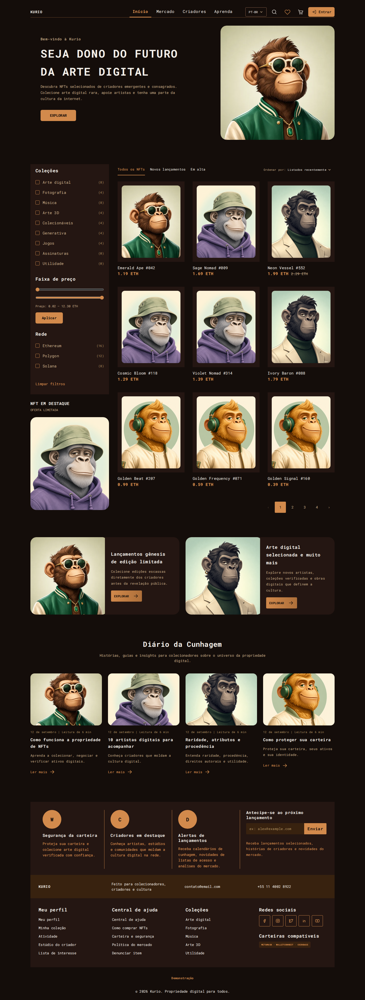
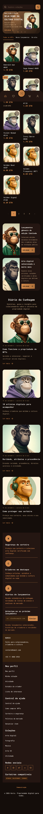

# Kurio — NFT Marketplace

Marketplace de NFTs com catálogo, conta do colecionador, carteiras e compra simulada. Interface responsiva baseada no [Figma do desafio](https://www.figma.com/design/Ff0SksUi7UFtPWUO8kyNtw/Frontend-Challenge?node-id=0-1), com versões em português e inglês.

**[Abrir demonstração](https://jungle-gaming-challenge-prd.vercel.app)** · [Homologação](https://jungle-gaming-challenge-hml.vercel.app) · [Releases](https://github.com/BragaHigor/jungle-gaming-challenge/releases) · [Arquitetura](docs/ARCHITECTURE.md) · [Contratos REST e eventos](docs/API.md)

Todos os usuários, NFTs, saldos, carteiras, pagamentos e referências de transação são fictícios. Não é necessário conectar uma carteira real nem fornecer dados pessoais.





As imagens acima são baselines do conjunto de regressão visual versionado.

## Executar com Docker

Requer Docker Desktop em modo Linux containers ou Docker Engine com Compose v2. Não exige Node/npm no computador nem arquivo `.env`.

```bash
git clone https://github.com/BragaHigor/jungle-gaming-challenge.git
cd jungle-gaming-challenge
docker compose up --build --detach --wait
```

Abra **http://localhost:8080**. A primeira construção baixa imagens e dependências públicas. O container serve o build otimizado, com mocks ativos, healthcheck e Nginx sem usuário root.

```bash
docker compose ps
docker compose logs -f app
docker compose down
```

Para outra porta no Bash: `PORT=8081 docker compose up --build --detach --wait`. No PowerShell, execute `$env:PORT = '8081'` antes do comando. Nesse caso, abra http://localhost:8081. A porta é publicada somente na interface local.

## Executar com Node

Versões utilizadas: **Node 22.19.0** e **npm 11.6.0**, definidas em `.nvmrc` e `package.json`.

```bash
npm ci
npm run dev
```

Abra http://localhost:5173. Para servir o build de produção:

```bash
npm run build
npm run preview -- --host 127.0.0.1
```

O preview usa http://127.0.0.1:4173. Use localhost/127.0.0.1 ou HTTPS: o Service Worker requer contexto seguro.

### Configuração

| Variável                    | Padrão                    | Uso                                                                   |
| --------------------------- | ------------------------- | --------------------------------------------------------------------- |
| `VITE_ENABLE_MOCKS`         | `true`                    | Ativa a rede simulada. Está em `.env.example`; `.env` é opcional      |
| `PORT`                      | `8080`                    | Porta do host no Docker Compose                                       |
| `GITHUB_SHA`                | `local`                   | Identificação do build em `/deployment.json`, preenchida pelo Actions |
| `DEPLOY_URL` / `DEPLOY_SHA` | Preview local / SHA local | Destino e SHA esperado no smoke                                       |

Desativar mocks não conecta a um backend alternativo: este repositório entrega a simulação. Variáveis `VITE_*` entram no código do navegador e não devem conter segredos. Nenhuma chave de blockchain, banco ou serviço privado é necessária.

## Explorar os fluxos

| Conta fictícia | E-mail                    | Senha        |
| -------------- | ------------------------- | ------------ |
| Colecionador   | `colecionador@kurio.demo` | `Kurio@2026` |
| Visitante      | `visitante@kurio.demo`    | `Kurio@2026` |

Também é possível cadastrar outra conta. As duas contas de exemplo permitem verificar o isolamento de favoritos, perfil, carteiras e pedidos. O catálogo inicial contém 36 NFTs; o cupom `KURIO10` aplica 10% de desconto no cenário padrão.

O checkout reaproveita nome, usuário, e-mail e ENS já salvos no perfil, além dos dados da carteira selecionada. Campos ainda não cadastrados ficam vazios; edições manuais são preservadas e não alteram automaticamente o perfil.

As contas padrão começam sem carteiras cadastradas. Antes da primeira compra, abra **Meu perfil → Carteiras** e cadastre a principal. Use, por exemplo, apelido `Minha carteira` e os dados fictícios do passo 3 abaixo. A secundária é opcional. Depois retorne ao carrinho; o checkout exige ao menos uma carteira cadastrada.

Para uma compra manual:

1. Abra um NFT, escolha edição/quantidade e adicione ao carrinho.
2. Entre em uma conta, aplique o cupom se desejar e siga para o pagamento.
3. Preencha os dados do colecionador ou selecione uma carteira cadastrada. Exemplos fictícios: nome `Alex Silva`, usuário `alexsilva`, e-mail `alex@example.com`, perfil `Minha coleção`, ENS `alex.eth`, indicação `KURIO`, endereço Ethereum `0x1111111111111111111111111111111111111111`, rede `Ethereum`, tipo `MetaMask`. O campo secundário e a observação são opcionais.
4. Revise, use **Conectar carteira simulada** e confirme. Nenhuma extensão é aberta e nenhum pagamento real ocorre.
5. Aguarde o resultado. Recarregar a confirmação recupera o pedido e mantém o snapshot do recibo.

Em **Meu perfil → Carteiras**, cadastre a principal e, depois, a secundária. Selecione o cartão correspondente para editar seus dados; a seleção do pagamento é independente da edição do perfil. O seletor PT-BR/EN mantém o idioma após refresh.

## Demonstração de falhas e recuperação

No rodapé, abra **Demonstração**, escolha um cenário e aplique. A demonstração guiada prepara dados fictícios e leva à tela correspondente. Um aviso identifica a simulação e oferece restauração/saída. Aplicar ou restaurar pode reiniciar os dados da demonstração; não use informações reais.

| O que avaliar                    | Cenários / ações                                                                                                   |
| -------------------------------- | ------------------------------------------------------------------------------------------------------------------ |
| Carregamento e falha no catálogo | Catálogo vazio, Rede lenta, Respostas fora de ordem, Falha de conexão, Tempo limite excedido, Serviço indisponível |
| Contratos e autorização          | Resposta inválida, Não autorizado, Acesso negado, Sessão expirada                                                  |
| Favoritos                        | Falha ao favoritar; observe o rollback e restaure para tentar novamente                                            |
| Carrinho                         | Cupom inválido/expirado, Falha na cotação, Preço alterado, Edição esgotada, Resumo lento                           |
| Conta                            | Leitura lenta, falha de leitura/escrita ou validação; o rascunho é preservado                                      |
| Pedido                           | Pendente, Confirmado, Recusado, Timeout na compra e Recusa de conexão da carteira                                  |
| Tempo real                       | Alterar NFT, resolver pedido, duplicar/repetir evento antigo ou enviar evento inválido; interromper e reconectar   |

Para verificar uma mudança **durante** a compra, mantenha um item no carrinho e utilize as ações de evento/conexão do painel. A cotação antiga deixa de permitir a confirmação; é necessário revisar os dados atuais. Para recuperação, mantenha um pedido pendente, interrompa a conexão e reconecte ou atualize a página. A mesma intenção de compra não cria outro pedido.

Use **Restaurar demonstração** para retornar ao cenário padrão. Os dados são persistidos no navegador por origem; Docker, preview e Vercel têm armazenamentos separados. Fechar o container não apaga esses dados. A [lista técnica dos cenários](docs/API.md#cenários-e-controle-da-demonstração) descreve os identificadores e os limites do transporte.

## Requisitos do desafio entregues

| Requisito obrigatório          | Implementação e evidência                                                                                                                  |
| ------------------------------ | ------------------------------------------------------------------------------------------------------------------------------------------ |
| Stack efetivamente integrada   | React/TypeScript, TanStack Router/Query, Axios/REST, Socket.IO, Tailwind, componentes locais shadcn/ui/Radix, MSW, Playwright e Lighthouse |
| Nove telas e responsividade    | Início, detalhe, carrinho, pagamento, confirmação, login, cadastro, perfil e carteiras; testes desktop/mobile e revisão em 390/768/1440 px |
| Estado de catálogo na URL      | Busca, filtros combinados, ordenação, paginação, histórico e refresh; contratos e cancelamento de leituras                                 |
| Conta e favoritos              | Cadastro/login/expiração/logout, retorno ao contexto anterior, isolamento por sessão e favorito otimista com rollback                      |
| Carrinho e precisão            | Persistência, merge do visitante, cupom, quantidades e valores em strings ETH com cálculo inteiro em wei                                   |
| Compra e recibo                | Cotação revalidada, carteira simulada, idempotência, estados pendente/confirmado/recusado, recuperação e snapshot imutável                 |
| Falhas na rede                 | MSW na camada de transporte, cenários determinísticos e reset consistente                                                                  |
| Tempo real                     | Cliente Socket.IO real exercitado pelo binding MSW; versões, deduplicação, descarte de eventos antigos e reconciliação REST                |
| Acessibilidade e skeletons     | Teclado, foco em diálogos, labels/erros, feedback acessível, shimmer e movimento reduzido                                                  |
| Testes e regressão visual      | 440 E2E, dez smoke e 72 verificações visuais; 16 baselines de início/detalhe/carrinho/pagamento versionadas                                |
| Auditorias Lighthouse          | 12 relatórios HTML/JSON e medianas por página/perfil. **Performance mobile abaixo da meta**, detalhada a seguir                            |
| Entrega reproduzível e pública | Lockfile, assets/fontes locais, mocks, testes, configuração de auditoria, URL pública e documentação dos contratos                         |

Os resultados e suas condições estão em [Validação e evidências](docs/VALIDATION.md). A tabela registra a entrega; não representa atribuição de nota ou conformidade integral de performance.

### Complementos além do mínimo

- **Docker:** build em múltiplos estágios, imagens fixadas por digest, Nginx sem root, filesystem somente leitura no Compose e healthcheck.
- **PT-BR e EN:** textos da interface via i18next, idioma persistente e testes de troca nos dois sentidos em desktop/mobile.
- **Zod:** validação em formulários, parâmetros da URL, entradas/saídas REST e envelopes de eventos, além dos tipos TypeScript.
- **Demonstração guiada:** cenários com navegação para a tela relevante, aviso de simulação e recuperação acessível ao avaliador.
- **CI/CD:** gates, artefato de build aprovado, smoke da URL única antes da promoção e do domínio estável depois, com conferência de SHA.
- **Fluxo de desenvolvimento:** branches de trabalho, PRs, proteção de develop/main, checks obrigatórios e Husky com gate local antes do commit.
- **Releases automáticas:** Conventional Commits, tags SemVer e GitHub Releases após publicação PRD validada.
- **Organização e manutenção:** páginas, componentes por contexto, hooks, contratos, transporte e mocks com responsabilidades separadas; decisões detalhadas em [ARCHITECTURE.md](docs/ARCHITECTURE.md).

## Comandos de qualidade

```bash
npm exec -- playwright install chromium
npm run test:e2e
npm run test:deploy
```

Em Linux sem dependências do navegador, use `npm exec -- playwright install --with-deps chromium`. Os testes funcionais/smoke iniciam seu próprio preview na porta 4180; mantenha-a livre e execute-os sequencialmente. Os contextos Playwright têm dados isolados.

| Comando                      | Finalidade                                                           |
| ---------------------------- | -------------------------------------------------------------------- |
| `npm run typecheck`          | Verificação TypeScript                                               |
| `npm run lint`               | ESLint sem warnings                                                  |
| `npm run format:check`       | Conferência Prettier                                                 |
| `npm run build`              | Tipos e bundle de produção                                           |
| `npm run test:e2e`           | Fluxos funcionais desktop/mobile                                     |
| `npm run test:deploy`        | Smoke local ou de `DEPLOY_URL`                                       |
| `npm run test:visual`        | Regressão visual sem atualizar baselines                             |
| `npm run test:e2e:report`    | Abrir o último relatório funcional                                   |
| `npm run test:visual:report` | Abrir o último relatório visual                                      |
| `npm run audit:lighthouse`   | Auditoria do build; exige `npm run build` antes                      |
| `npm run check:commit`       | Formato, lint, build, E2E e smoke; usado pelo Husky                  |
| `npm run release:dry-run`    | Prévia de versão/notas sem publicar; configuração direcionada à main |

As baselines visuais são Linux/Chromium. Use o ambiente fixado no [workflow visual](.github/workflows/visual.yml) para comparação reproduzível. `test:visual:update` é uma ação deliberada de manutenção; não é solução automática para falha e é bloqueada em CI.

## Performance e limites conhecidos

Medições locais de referência da v1.0.0 em 22/10/2026, anteriores ao complemento de preenchimento do checkout; três execuções por página/perfil, build completo e mocks padrão:

| Página / perfil   | Performance | Accessibility | Best Practices | SEO |
| ----------------- | ----------: | ------------: | -------------: | --: |
| Início / mobile   |          72 |           100 |            100 | 100 |
| Detalhe / mobile  |          74 |           100 |            100 | 100 |
| Início / desktop  |          99 |           100 |            100 | 100 |
| Detalhe / desktop |          99 |           100 |            100 | 100 |

A meta de Performance ≥ 90 não foi atingida no mobile. Avaliação de JavaScript, inicialização do transporte MSW e atraso de renderização do conteúdo principal foram os gargalos identificados. A auditoria retorna falha abaixo das metas e permanece manual, sem bloquear deploy. Não foram reduzidos os limites nem removidas funcionalidades para elevar a nota. [Relatórios, métricas e ambiente](docs/VALIDATION.md#lighthouse).

A simulação browser-side não oferece segurança equivalente a um backend. O binding usa WebSocket, sem servidor Socket.IO externo nem fallback polling; o broadcast é local ao documento. Os assets de NFTs são reutilizados entre itens fictícios. Páginas editoriais, ofertas, suporte e downloads ficam fora do escopo e mostram feedback de indisponibilidade, sem fingir uma operação concluída.

## Branches, CI/CD e versões

Branches de trabalho partem de `develop` e voltam por PR. `develop` publica HML; a promoção para `main` publica PRD. Ambas são protegidas por PR, checks, resolução de conversas e bloqueio de force push/exclusão, sem bypass. Atualizações de branches protegidas também passam por PR.

A suíte E2E completa roda em PRs e execução manual. Após merge, o deploy não repete a suíte funcional completa: mantém formato/lint/build, regressão visual e smoke. O deploy usa o artefato do mesmo run/SHA e a integração Git automática da Vercel está desativada para evitar publicação duplicada. Relatórios de testes ficam nos artifacts por sete dias; Lighthouse, 14 dias. Há [cópias de referência versionadas](docs/VALIDATION.md) para não depender apenas dessa retenção.

O semantic-release está ativo somente na `main`, após gates, dry-run e smoke PRD. A primeira release é [v1.0.0](https://github.com/BragaHigor/jungle-gaming-challenge/releases/tag/v1.0.0). `fix:` gera patch; `feat:`, minor; `BREAKING CHANGE`/`!`, major. Commits apenas `docs:`, `chore:` ou `ci:` normalmente não geram nova versão. Sem mudança elegível, não há release adicional.

São identificadores diferentes:

- **Manifesto:** `package.json` permanece em `0.1.0`; não há plugin para editar esse campo ou publicar no npm.
- **Release:** tag SemVer e notas no GitHub, calculadas pelo histórico de commits.
- **Build:** `/deployment.json` contém o SHA exato e a ativação dos mocks. O SHA muda por deploy mesmo quando não há nova versão SemVer.

Para conferir publicação, tag, SHA e limites das evidências, veja [Validação e evidências](docs/VALIDATION.md).
