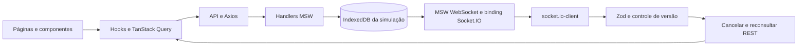

# Arquitetura e decisões

## Visão geral

SPA React/TypeScript construída com Vite. O mesmo fluxo de transporte é utilizado no desenvolvimento, na demonstração pública, no Docker e nos testes: componentes consomem hooks, hooks usam TanStack Query e funções da camada `api`, Axios envia REST e MSW responde na camada de rede. Os dados são validados por Zod antes de entrar no estado da aplicação.



O painel de demonstração chama endpoints de controle. Para as ações de alteração em tempo real, o handler modifica o banco e emite o evento pelo binding; a UI reconcilia pela API. A seleção de um cenário guiado pode preparar fixtures de um estado terminal para inspeção, identificadas pelo aviso de demonstração. Isso é distinto de confirmar uma compra comum: no checkout, o recibo só é exibido após um pedido confirmado pelo transporte simulado.

## Estrutura

```text
src/
  app/          composição, providers, Router e QueryClient
  pages/        telas e coordenação dos fluxos
  components/   account, catalog, demo, layout, nft, purchase, shared e ui
  api/          funções REST, Axios e validação das respostas
  hooks/        consultas, mutations e ciclo de vida dos recursos
  services/     sessão, assinatura Socket.IO e intenção de pedido
  schemas/      formulários, URL, contratos REST e eventos Zod
  mocks/        handlers, cenários, banco e transporte Socket.IO simulados
  constants/    categorias, redes, destinos e configuração
  i18n/         recursos PT-BR/EN e configuração
  styles/       tokens e estilos globais/Tailwind
  types/        tipos de apresentação e composição
  utils/        ETH, formulários, busca e funções pequenas
tests/          E2E, smoke, visual, helpers e baselines
public/         worker, imagens WebP, ícones e recursos públicos
docker/         configuração Nginx
docs/           contratos e evidências da entrega
```

Componentes são agrupados pelo contexto de uso. Primitivas compartilhadas permanecem em `components/ui`; não há uma camada genérica de repositório para cada endpoint nem abstração que apenas encaminha uma chamada sem responsabilidade própria.

Os padrões aplicados são composição de componentes/providers, hooks para recursos assíncronos, adaptador de transporte em `api`, schemas como fronteira de validação e funções de domínio no mock. Serviços com estado possuem encerramento explícito. Condições complexas são extraídas em valores/funções locais para tornar decisões legíveis, sem espalhar regras de negócio pelos componentes.

## Rotas e experiência

| Rota                      | Acesso / estado                                                   |
| ------------------------- | ----------------------------------------------------------------- |
| `/`                       | Público; filtros e paginação na query string                      |
| `/nfts/$nftId`            | Público; seleção de edição/quantidade e tratamento de inexistente |
| `/cart`                   | Visitante ou conta; carrinho persistente                          |
| `/checkout`               | Conta válida e contexto de compra                                 |
| `/confirmation?orderId=…` | Conta válida, autorização do pedido e estado real consultado      |
| `/login`, `/register`     | Formulários em diálogo contextual ou acesso direto                |
| `/profile`, `/wallets`    | Conta válida; edição de recursos privados                         |

TanStack Router valida search params com Zod. O catálogo serializa busca, categorias/redes, limites de preço, aba, ordenação e página. Filtro novo volta à primeira página. Valores inválidos da URL são normalizados; requisições API inválidas retornam erro de contrato/validação, sem aceitar silenciosamente payload de mutation malformado.

Autenticação contextual preserva a página atrás do diálogo, filtros, scroll e foco. `safeReturn` aceita apenas caminhos internos previstos, impedindo redirecionamento externo. Guards verificam sessão antes das rotas privadas; handlers também verificam dono e sessão. Uma URL de confirmação não cria nem confirma pedidos.

Navegação inferior é reservada aos contextos apropriados em mobile; checkout e estados de compra não herdam espaço vazio de uma barra ausente. Diálogos, drawers, seleção de carteiras e alterações de formulário têm feedback, preservação de rascunho e proteção contra abandono quando aplicável.

## Cache, concorrência e erros

O [QueryClient](../src/app/query-client.ts) tem `staleTime=30s`, `gcTime=5min`, uma repetição de leitura por padrão e nenhuma repetição automática de mutation. Recursos privados e operações sensíveis ajustam essa política:

| Recurso            | Chave / política                                                                              |
| ------------------ | --------------------------------------------------------------------------------------------- |
| Catálogo           | `['nfts','list',queryNormalizada]`; mantém resultado anterior enquanto atualiza               |
| Detalhe            | `['nfts','detail',id]`; versão do NFT é referência para eventos                               |
| Privados           | `['private',userId,token,recurso,…]`; perfil/carteiras/favoritos/pedidos sem retry automático |
| Carrinho visitante | `['cart','visitor',…]`; isolado do carrinho autenticado                                       |
| Cotação do resumo  | Escopo do carrinho + versão + versões dos NFTs + rede; staleTime de 30s, sem retry            |
| Sessão             | `['session']`; staleTime zero, sem retry e validação na API                                   |

No catálogo/detalhe, erros 4xx e contratos inválidos não são repetidos; falhas transitórias podem repetir uma vez. Axios tem timeout de três segundos. AbortSignal cancela leituras substituídas; respostas e mutations tardias também conferem token/escopo antes de escrever cache. O cancelamento de uma requisição não é tratado como rollback garantido de uma operação já persistida: pedidos usam idempotência para esse caso.

Favoritos aplicam atualização otimista: cancelam leitura concorrente, guardam snapshot, atualizam o cache do usuário e restauram o snapshot em erro. Confirmação da API e invalidação posterior reconciliam o resultado. Troca de conta impede rollback ou sucesso antigo de atingir o novo usuário.

Carrinho serializa escritas na UI e exige `cartVersion` nas alterações aplicáveis. Perfil/carteiras usam `version`. O banco simulado atualiza recursos em transação IndexedDB, protegendo operações entre abas. A geração do cenário é conferida após latência/trabalho assíncrono; reset não permite que uma resposta antiga reintegre o estado anterior.

Zod valida entradas, saídas, invariantes dos totais e envelopes de eventos. `ApiError` distingue código HTTP de `NETWORK`, `TIMEOUT` e `CONTRACT`. Erros retornam códigos estáveis, traduzidos pela apresentação; campos inválidos recebem mensagens associadas. Durante uma atualização, conteúdo estável pode permanecer visível; falhas não fabricam valores substitutos ou confirmação.

## Sessão e limites de segurança

Token opaco em `sessionStorage`, válido por uma hora na simulação, com `Authorization: Bearer`. A sessão é recuperada consultando `/api/session` após refresh; outra aba não herda automaticamente o token. Expiração é observada pelo provider/401 da API, com retorno seguro ao contexto anterior.

Login faz merge do carrinho visitante. Logout/troca cancelam queries privadas, removem caches pertinentes e encerram a assinatura do socket anterior. Listeners verificam token, geração e dono; uma resposta de 401 enviada com token antigo não encerra uma sessão nova.

Senhas não são persistidas em claro: PBKDF2/SHA-256, salt e 100.000 iterações via Web Crypto. Alteração de senha exige a atual e invalida outras sessões do mesmo usuário. Os dados de exemplo e seus hashes fazem parte da fixture pública.

**Não há fronteira de segurança real no navegador.** O avaliador pode inspecionar/alterar IndexedDB e o código do mock. Esses mecanismos demonstram isolamento e comportamentos de API, não substituem autenticação/autorização em servidor, cookies HttpOnly, proteção contra ataques ou controles de um sistema financeiro. Use apenas dados fictícios.

## Carrinho, valores e cotação

Identidade da linha: NFT + edição. Quantidades inteiras de 1 a 99, limitadas pela edição/estoque. O visitante tem carrinho próprio; o login mescla quantidades respeitando limites e informa merge parcial quando necessário. Caches de outro usuário não são reaproveitados.

ETH trafega como string decimal canônica, com até 18 casas. [utils/eth.ts](../src/utils/eth.ts) converte para wei usando BigInt. Subtotal e desconto percentual são calculados com inteiros; a divisão inteira determina o arredondamento do desconto. Formatação não usa float como referência contábil.

A API retorna subtotal, desconto, taxa e total. As taxas fictícias por rede são Ethereum `0.016`, Polygon `0.002` e Solana `0.0005` ETH. A cotação expira em dois minutos e vincula carrinho/versão, carteira/rede, cupom e versões dos NFTs. Uma cotação compatível ainda válida pode ser reaproveitada; preço/estoque, cupom, expiração ou contexto alterado exigem revalidação e nova revisão quando indicada. O checkout não usa apenas o total mostrado no componente como autorização de compra.

## Dados do colecionador no checkout

O formulário parte do perfil autenticado (nome, username, e-mail e ENS) e dos dados já salvos na carteira selecionada (perfil, indicação, endereço, rede, provedor e campo secundário). Não há valores fictícios inseridos como preenchimento quando o campo está ausente. A carga inicial do perfil precede a abertura do formulário; falha permite preenchimento manual com o contexto conhecido da conta/carteira.

Os valores iniciais são capturados uma vez por montagem/sessão, preservando a digitação durante refetch/reconciliação. Troca explícita da carteira atualiza seus campos, sem sobrescrever os metadados que o usuário editou manualmente. Uma tentativa de pedido pendente tem prioridade sobre os valores padrão para preservar seu payload/idempotência. Não são copiados dados de outra conta, senhas ou informações de pedidos antigos; preencher o checkout não salva alterações no perfil automaticamente.

## Pedido, idempotência e recuperação

O formulário é validado antes da revisão. A conexão de carteira é simulada pela API, associada a usuário, token, endereço, rede e provedor. Não há extensão, assinatura criptográfica ou transferência de fundos.

Uma intenção de compra salva `{key,input}` em `sessionStorage`, por usuário. `POST /orders` envia a mesma `Idempotency-Key` ao repetir uma tentativa após timeout. O handler autentica o usuário, consulta primeiro a chave existente e compara o payload: conteúdo idêntico recupera o pedido; diferente retorna conflito. O fluxo não gera uma chave nova apenas porque a resposta da primeira chamada não chegou.

A criação revalida cotação, dono, conexão, carteira, versão do carrinho, preço e disponibilidade. Reserva estoque e persiste o snapshot do pedido em transação. O estado começa pendente e só passa para confirmado ou recusado; terminais não regridem.

Em confirmação, são subtraídas apenas as quantidades das linhas compradas; itens adicionados depois são preservados. Em recusa, o estoque reservado é liberado e o carrinho permanece. O recibo usa os itens/valores do pedido, não refaz a conta com preços atuais do catálogo.

O agendamento da resolução pertence à simulação. Ao consultar/reconectar após refresh, o mock pode resolver um agendamento vencido persistido; não depende de o temporizador da aba original continuar vivo. Sem `orderId`, a tela pode recuperar o último pedido próprio. Pedidos de outro usuário não ficam acessíveis pelo identificador.

## Eventos e reconciliação

Cliente `socket.io-client` conectado à origem atual, path `/socket.io/`, transporte WebSocket. MSW intercepta WebSocket e `@mswjs/socket.io-binding` fornece a compatibilidade de protocolo usada na demonstração. Não há servidor externo ou fallback long-polling.

`nft.updated` e `order.updated` incluem identidade, recurso, versão e geração; pedidos incluem dono. O cliente valida o envelope e os vínculos com o payload, rejeita eventos de outra geração/sessão/usuário, identifica duplicatas e ignora versões anteriores ao recurso conhecido. O conjunto de identidades é limitado a 256 entradas por assinatura, complementado pelo mapa de versões.

Evento aceito dispara cancelamento e invalidação das consultas relevantes, com refetch dos recursos ativos pela REST. Ao conectar/reconectar, perfil, carteiras, favoritos, carrinho, catálogo e pedidos ativos também são reconciliados. Não é presumido replay completo de todos os eventos perdidos. Reconciliações simultâneas são serializadas e repetidas quando outra solicitação chega durante o trabalho.

Reconexão automática faz até três tentativas, atraso de 300–600ms, sem jitter no mock. Reconexão manual encerra a tentativa/conexão anterior antes de abrir outra. Cleanup remove listeners, desconecta o socket e limpa os mapas; o reset fecha conexões e descarta temporizadores/geração antigos.

Persistência é compartilhada entre abas da mesma origem via IndexedDB; a emissão de eventos do binding é local ao documento. Não é implementado broadcast de socket entre dispositivos/abas como um backend distribuído faria.

## UI, idioma e assets

Tailwind constrói o visual, com tokens CSS e primitivas locais baseadas em shadcn/ui/Radix. i18next mantém PT-BR/EN, preferência em localStorage e `html.lang`. Alterar idioma não troca o recurso, a cotação ou os dados digitados.

Formulários têm labels/erros associados, foco visível e campos obrigatórios identificados. Diálogos/drawers administram foco, retorno e rolagem. Skeletons com shimmer reservam dimensões em catálogo/detalhe/resumo; movimento reduzido é respeitado. Eventos/mutations têm feedback acessível, além da cor.

Assets de referência são locais, com NFTs em WebP e fonte Roboto Mono WOFF2. O envelope de confirmação foi redesenhado em SVG a partir da referência PNG; favicon e ícones complementares são locais. Algumas artes são reutilizadas pelos 36 itens fictícios. Não há promessa de 36 imagens exclusivas.

Adaptações deliberadas do Figma: perfil/carteiras/confirmação mobile quando não há frame específico; estados de erro/carregamento/pendência, validação obrigatória e avisos de simulação; diálogo de login contextual, seletor de idioma e foco/contraste; distinção das carteiras cadastradas. Baselines registram a implementação, não substituem uma comparação humana com o Figma nem comprovam equivalência pixel a pixel.

Newsletter, navegação editorial e itens de conta fora do escopo têm comportamento explícito. Ações sem backend próprio não exibem falso sucesso de assinatura ou download.

## Build, Docker e entrega

Rotas de conta/compra/confirmação são carregadas sob demanda. Bootstrap e preparação dos mocks começam em paralelo; renderização só prossegue com a rede simulada pronta. Fontes/imagem inicial têm preload, primeira linha de cards tem prioridade e as demais imagens usam lazy loading.

Docker tem build Node/npm fixados e runtime Nginx Alpine, ambos por digest. Só `dist` vai para a imagem final. Compose usa usuário não root, filesystem somente leitura, tmpfs para temporários, capabilities removidas, healthcheck e binding local. Assets hash têm cache imutável; HTML, worker e metadata exigem revalidação. Fallback SPA mantém acesso direto às rotas. Não há volume de banco: dados pertencem ao navegador.

PRs para develop/main executam o E2E integral e visual. Push integrado publica HML/PRD, com CI de formato/lint/build/smoke e visual, sem repetir os 440 casos. Publicação usa o build aprovado do mesmo run, valida metadata/SHA e executa smoke antes/depois da promoção. Uma branch que mudou durante o smoke não é promovida. Integração Git automática da Vercel fica desativada para evitar deploy duplicado.

Main e develop exigem PR, resolução de conversas e checks, sem bypass. Sincronizar uma branch protegida exige branch intermediária e PR; o botão Update branch não substitui essa regra quando a origem também é protegida.

Release roda somente depois do deploy/smoke PRD, usa histórico/tags completos e token temporário `GITHUB_TOKEN` limitado ao job. Tag e release identificam a versão; o manifesto não é alterado. O próximo commit sem mudança elegível não cria versão adicional. A v1.0.0 e seu SHA estão registrados em [VALIDATION.md](VALIDATION.md).

Falha antes da promoção preserva o domínio estável. Falha depois exige investigação e rollback para um deployment conhecido, seguido de conferência de metadata e smoke do SHA anterior. Release não deve prosseguir com smoke reprovado. Não há rollback destrutivo de banco nem movimentação de tags; o projeto usa dados fictícios no navegador.

## Validação e limite de performance

[VALIDATION.md](VALIDATION.md) registra suíte funcional, regressão visual, Docker, auditorias e evidências públicas. Relatórios copiados para a entrega mantêm sua identificação original; relatórios locais não são apresentados como medições do deploy público.

Lighthouse: desktop Performance 99 nas duas rotas, demais categorias 100; mobile 72/74, abaixo de 90. Os perfis oficiais e as funcionalidades foram preservados. JavaScript/transporte MSW e atraso de renderização mobile permanecem gargalos. Ganhos locais medidos incluem imagem principal 83,85% menor, menos renderizações da hero e redução de leituras IndexedDB por consulta; uma comparação Lighthouse alternada não demonstrou ganho global consistente de nota. Não são alegados resultados superiores aos relatórios.
